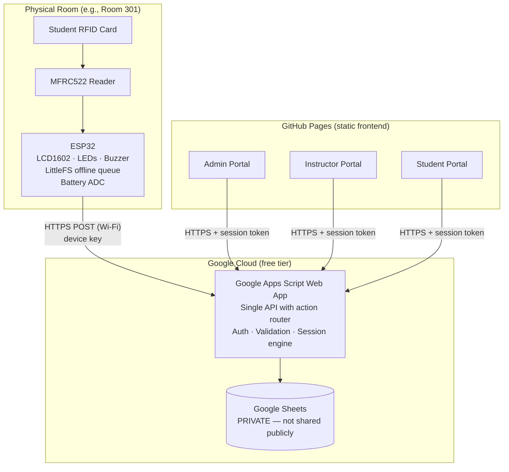
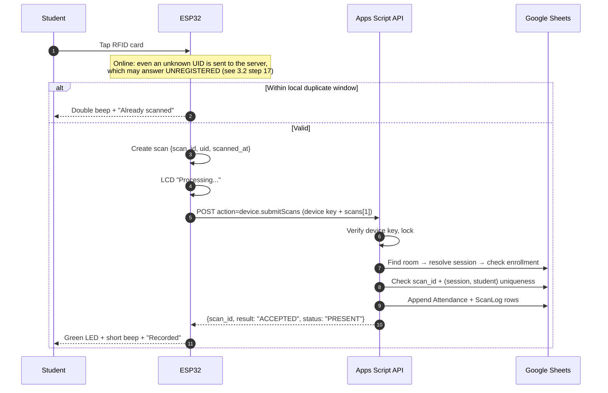
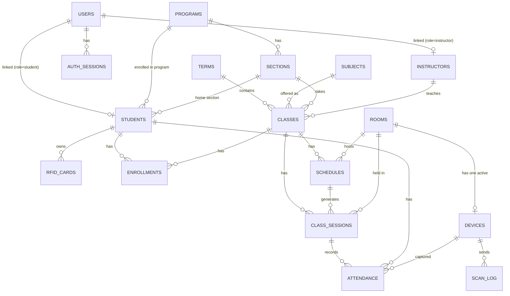
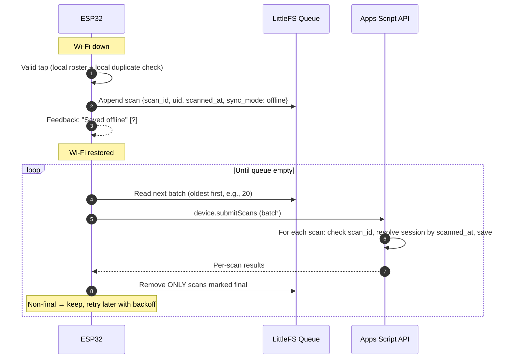

# Proposed System Architecture
## IoT-Based RFID Attendance Monitoring System
Pampanga State University – Department of Computer Engineering

| | |
|---|---|
| Document status | **PROPOSED – awaiting team approval** (six schema decisions finalized, see 1.2) |
| Version | 0.2 (draft) |
| Date | November 4, 2026 |
| Sources | Project Proposal (Oct 27, 2026), PROJECT_CONTEXT, approved software decisions #1–#9, finalized decisions F1–F6 |
| Companion files | `Device_API_Spec.md` (for the ESP32 programmer), `backend/seed/seed-data.json` (fake test data) |
| Superseded by | `CLAUDE.md` where they differ: password login (no Google Sign-In), a tap is always PRESENT (no `late_grace_minutes`), fake data only from `seed-data.json`, production setup in `PRODUCTION_SETUP.md`. |
| Changelog | v0.2: Google Sign-In + internal registration; time-in only; per-class enrollment; one active card; configurable late grace; excused deferred; Apps Script redirect handling corrected; setup checklist added |
| Implementation status | **Nothing in this document is implemented yet.** No code, sheets, or APIs exist yet. |

---

## 0. How to Read This Document

Every feature in this document is tagged so we never confuse "proposed" with "done":

| Tag | Meaning |
|---|---|
| **[P]** | From the **original project proposal** (hardware and core requirements) |
| **[S]** | **Approved software expansion** (decisions #1–#9 approved after the proposal) |
| **[R]** | **Recommendation** from this architecture — needs team approval |
| **[?]** | **Unresolved decision** — listed in Section 9, must be answered before or during implementation |

Diagrams use Mermaid syntax. GitHub renders Mermaid automatically, so they will display properly once this file is in the repository.

---

## 1. Scope Summary

### 1.1 Original proposal features [P]

| Feature | Source |
|---|---|
| Read RFID cards with MFRC522 + ESP32 and validate against a student list | Objective 1 |
| Timestamp each valid scan (NTP) and upload to Google Sheets via Google Apps Script | Objective 2 |
| Offline buffering in ESP32 flash (LittleFS), removed only after server confirmation | Additional Feature 1 |
| LED + buzzer feedback: accepted / duplicate / unregistered | Additional Feature 2 |
| Battery voltage monitoring with dashboard low-battery alert (initial threshold ≈ 3.5 V) | Additional Feature 3 |
| Duplicate-scan prevention (initial 5-minute window, adjustable) | Additional Feature 4 |
| Web dashboard displaying attendance records | Basic Feature 4 |
| LCD1602 display of scan results and network status | Objective 3, Risk Mgmt |
| Battery operation: 2× 18650 (2P), TP4056, MT3608 boost to 5 V | Section VIII |

### 1.2 Approved software expansions [S]

| # | Decision |
|---|---|
| 1 | Admin manages students, RFID cards, instructors, subjects, classes, rooms, schedules, devices |
| 2 | Instructors view and monitor their assigned classes and attendance |
| 3 | Students view only their own attendance records |
| 4 | One ESP32 + MFRC522 device is permanently assigned to each physical room |
| 5 | Multiple classes share a room (and its device) at different times |
| 6 | Class sessions are automatically identified from room assignment + class schedule |
| 7 | Instructors can manually start or override a session |
| 8 | Every attendance record is linked to a specific class session |
| 9 | Offline attendance is queued and synchronized without loss or duplicates |

### 1.2.1 Finalized decisions (November 4, 2026) [S]

| # | Decision | Effect on design |
|---|---|---|
| F1 | **Login: Google Sign-In + internal registration.** Google verifies identity; the system then checks that the email is registered and active in our Users sheet. Only admins register users and assign roles. **No public self-registration.** | No passwords stored at all. See Section 12 for setup and limitations |
| F2 | **Time-in only** for the MVP | One attendance row per student per session; no time-out columns |
| F3 | **Per-class enrollment**, with an "enroll entire section" shortcut | Enrollments table is required; irregular students supported |
| F4 | **One active RFID card per student** for the MVP, with replace and revoke | RfidCards table with status history |
| F5 | **Late status included**; grace period configurable in Settings | `late_grace_minutes` setting (+ optional per-class override) |
| F6 | **Excused status excluded** from the MVP; future version | Attendance status is only `present` / `late`; absent is computed |

### 1.3 Approved technology stack (unchanged) [P]

| Layer | Technology |
|---|---|
| Device firmware | Arduino IDE, ESP32 Arduino Core, WiFi.h, HTTPClient.h, MFRC522, LiquidCrystal_I2C, LittleFS |
| Device ↔ server | HTTP(S) requests to Google Apps Script |
| Backend / API | Google Apps Script (deployed as a Web App) |
| Database | Google Sheets (private, accessed only through Apps Script) |
| Frontend | HTML, CSS, JavaScript, Bootstrap |
| Hosting | GitHub Pages |
| Future upgrade (not now) | Firebase Authentication + Firestore |

No new hardware components and no paid services are introduced in this document.

---

## 2. High-Level Architecture



### Key ideas (beginner explanation)

1. **The Google Sheet is never accessed directly by the browser or the ESP32.** Lahat dumadaan sa Apps Script. The Sheet stays private (not "anyone with the link"). Apps Script is the "security guard" that checks who is asking and what they are allowed to see.
2. **The ESP32 does not decide which class a scan belongs to.** It only reports *"card X was tapped at time T on device D."* The server figures out the class session. This keeps the firmware simple and lets the admin change schedules without reflashing devices.
3. **The frontend is just a static website.** It has no secrets inside it. Even if someone reads the JavaScript, they get nothing useful without a valid login.
4. **The ESP32 has its own credentials** (a device key), separate from any human login [P: PROJECT_CONTEXT §11].

### 2.1 Platform notes to be aware of [R]

These are real behaviors of Google Apps Script that affect our design:

| Behavior | Impact | How we handle it |
|---|---|---|
| Apps Script Web App URLs respond with an HTTP **302 redirect** before returning the result. The POST is already processed at the first hop; the result must be fetched from the redirect URL with **GET** | Re-POSTing to the redirect URL fails (HTTP 405), and reusing one TLS client across the host change can break | Firmware disables automatic redirects, reads the `Location` header, then does a fresh **GET** (details in `Device_API_Spec.md`) |
| Apps Script always replies **HTTP 200** for script-handled requests (it cannot set custom status codes) | Device and frontend cannot rely on HTTP status codes for errors | Always read the JSON `ok` field and error code |
| Apps Script `doPost(e)` **cannot read custom HTTP headers** | Can't send `Authorization: Bearer ...` headers | Credentials/tokens go inside the JSON body |
| Apps Script does not handle CORS preflight (`OPTIONS`) requests | Browser `fetch()` with `Content-Type: application/json` gets blocked | Frontend sends JSON as `Content-Type: text/plain` (no preflight) |
| Multiple requests can run at the same time | Two scans could write conflicting rows | All writes wrapped in `LockService` |
| First request after idle can be slow ("cold start", often 1–3+ seconds) | Device feedback delay | LCD shows "Processing..."; measure actual delay in testing [P: Testing Plan] |
| Google Sheets auto-converts text like `2026-11-04` or `08:00` into dates | Corrupted date/time comparisons | Format date/time/ID columns as **Plain Text** |
| Apps Script has daily quotas and execution-time limits | Very high traffic could hit limits | Fine for one department; verify against Google's published quotas during testing |

---

## 3. (A) Complete System Workflow

### 3.1 Big picture: from setup to scanning

```mermaid
flowchart LR
    A[1. Admin setup<br/>terms, rooms, devices,<br/>subjects, sections] --> B[2. People<br/>instructors, students,<br/>RFID cards]
    B --> C[3. Classes<br/>subject + section +<br/>instructor + term]
    C --> D[4. Schedules<br/>class + room +<br/>day + time]
    D --> E[5. Enrollment<br/>students → classes]
    E --> F[6. Device sync<br/>ESP32 downloads<br/>roster + settings]
    F --> G[7. Scan day<br/>student taps card]
    G --> H[8. Server resolves<br/>class session]
    H --> I[9. Attendance saved<br/>+ device feedback]
    I --> J[10. Portals show data<br/>admin / instructor / student]
```



### 3.2 Step-by-step

**Phase 1 — One-time admin setup** [S]
1. Admin logs in to the Admin Portal.
2. Admin creates the **Academic Term** (e.g., "1st Semester AY 2026–2027") with start and end dates.
3. Admin creates **Rooms** (e.g., Room 301, CpE Lab 2).
4. Admin registers **Devices** and assigns each to one room. The system generates a **device key** that the hardware team puts into the firmware configuration. The key is shown once, then only a hashed version is stored.
5. Admin creates **Programs** (e.g., BSCpE), **Sections** (e.g., CpE 3A), and **Subjects** (e.g., CPE 401 – Embedded Systems).

**Phase 2 — People and cards** [S]
6. Admin creates **Instructor** records and registers their Google email + role [F1].
7. Admin creates **Student** records and registers their Google email + role [F1]. There is no public sign-up page.
8. Admin registers **RFID cards**: taps the card on a device (or types the UID), and links the UID to a student. One active card per student; old cards are revoked when replaced [F4]. [?: UID capture method — see Section 9 #18]

**Phase 3 — Classes and schedules** [S]
9. Admin creates a **Class** = Subject + Section + Instructor + Term (e.g., "CPE 401 – CpE 3A – Engr. Cruz – 1st Sem").
10. Admin adds one or more **Schedule slots** to the class: room + day of week + start time + end time (e.g., Room 301, Mon & Wed, 08:00–10:00).
11. The system **rejects overlapping schedules** in the same room (and warns about instructor overlaps).
12. Admin **enrolls students** into the class (bulk-enroll a whole section, then add/remove irregular students) [F3].

**Phase 4 — Device preparation** [P + S]
13. When powered on, the ESP32 connects to Wi-Fi and syncs time via NTP [P].
14. ESP32 downloads the **roster** (list of active registered UIDs) and **settings** (duplicate window, etc.) and caches them in flash [P: "student list... cached in the ESP32's flash memory"].
15. ESP32 sends periodic **heartbeats** (battery voltage, Wi-Fi signal, queue size) [P: battery monitoring].

**Phase 5 — Class day: scanning** [P + S]
16. Student taps card → MFRC522 reads UID → ESP32 receives it [P].
17. ESP32 checks the local roster [P]. **Offline:** unknown UID → red LED + long beep + "Unregistered" immediately. **Online:** the UID is still sent to the server, because the cached roster may be stale and the server is the source of truth; the server answers `UNREGISTERED` and logs the UID so an admin can assign it [R].
18. ESP32 checks its local duplicate window: same UID within window → double beep + "Already scanned" [P].
19. ESP32 creates a scan record with a **unique scan ID** and an NTP timestamp [P + R].
20. If online, ESP32 uploads the scan and waits for confirmation. If offline or upload fails, it saves the scan to the LittleFS queue [P].
21. Server receives the scan, verifies the device key, finds the device's room, and **resolves the class session** (Section 4).
22. Server checks the student is **enrolled** in that class, checks for an existing record in that session, and saves the attendance row with status *present* or *late* [S].
23. Server replies with a result code; ESP32 shows the matching LED/buzzer/LCD feedback [P].

**Phase 6 — Monitoring and reporting** [S]
24. Instructor sees live attendance for the open session, plus history and reports for their classes.
25. Student sees their own attendance summary, percentage, and history.
26. Admin sees everything, plus device status and low-battery alerts.

### 3.3 Live scan sequence (online)



---

## 4. (B) How One Device Serves Multiple Classes in the Same Room

### 4.1 The idea

The device is tied to a **room**, not to a class [S #4]. The **schedule** tells the server which class "owns" the room at any given time [S #5, #6].

Example — Room 301, Monday:

| Time | Class | Instructor |
|---|---|---|
| 07:30–09:00 | CPE 401 – CpE 3A | Engr. Cruz |
| 09:00–10:30 | CPE 302 – CpE 2B | Engr. Santos |
| 13:00–16:00 | CPE 405L – CpE 4A (lab) | Engr. Reyes |

A tap at 09:10 on the Room 301 device → server looks up the Room 301 schedule for Monday → finds CPE 302 → records attendance under today's CPE 302 session.

### 4.2 Session resolution rules [R]

When a scan arrives with `device_id` and `scanned_at`:

1. **Find the room** from the device record. (Device not assigned to a room → reject `DEVICE_NOT_ASSIGNED`.)
2. **Manual sessions first.** If an instructor manually opened a session in this room that covers `scanned_at`, use it. Manual always wins over automatic [S #7].
3. **Automatic sessions.** Find schedule slots for this room where:
   - the term is active and `scanned_at` falls within term dates,
   - the day of week matches,
   - `start_time − early_window ≤ scan time ≤ end_time` [? early window length, accept-after-end rule].
4. **Get or create the session.** The `ClassSession` row for that (schedule slot, date) is created automatically on the first scan ("lazy creation"). Only one session can exist per schedule slot per date.
5. **Boundary tie-breaker** (back-to-back classes, e.g., early window of the 09:00 class overlaps the end of the 07:30 class):
   - prefer the candidate session where the **student is enrolled**;
   - if enrolled in both, prefer the one where the student **does not yet** have a record;
   - otherwise prefer the session that is currently in progress.
6. **No matching session** → scan is logged as `NO_ACTIVE_SESSION` (not lost — admin can see it).
7. **Cancelled session** (e.g., holiday, instructor cancelled) → `SESSION_CANCELLED`.

### 4.3 Present vs. late [F5]

`late_grace` = the class's `late_grace_minutes` if set, otherwise the global `late_grace_minutes` setting (default value still to confirm).

- `scanned_at ≤ session start + late_grace` → **PRESENT**
- `scanned_at > session start + late_grace` → **LATE**
- Enrolled students with no record when the session closes → **ABSENT** (computed, see Section 9)

### 4.4 Manual start and override [S #7]

| Instructor action | What happens |
|---|---|
| **Start session now** | Creates a manual session for one of *their* classes in a chosen room, with start and planned end time. Used for make-up classes or room changes. |
| **Extend / end early** | Changes `actual_end` of an open session. |
| **Cancel session** | Marks the session cancelled; scans during that time are rejected with `SESSION_CANCELLED`. |
| **Conflict** | If another class is scheduled or open in that room at that time [?: block, or allow with admin approval]. |

All manual actions are recorded in the audit log (who, when, what changed, reason).

### 4.5 Why the server decides, not the ESP32 [R]

| Option | Pros | Cons |
|---|---|---|
| ESP32 downloads schedules and decides the session | Works fully offline | Firmware becomes complex; schedule changes need re-sync; bugs are hard to fix in deployed devices |
| **Server decides (recommended)** | Simple firmware; schedule changes take effect instantly; one source of truth | Device can't show the class name for offline scans |

Offline scans still work: the device saves the **timestamp**, and the server resolves the session later using that timestamp. Kaya importante na tama ang oras ng device (Section 6.4).

---

## 5. (C) Database Design (Google Sheets)

### 5.1 General rules [R]

- **One worksheet = one table.** Row 1 contains column headers. Never reorder columns after go-live without a migration.
- **IDs are generated by Apps Script**, never typed manually, never reused. Format: prefix + number (e.g., `STU-000123`, `CLS-000045`) for easy debugging.
- **No hard deletes for core records.** Use `status` (`active` / `inactive` / `archived`) so history stays intact.
- **Sheets has no foreign keys or unique constraints.** Apps Script must enforce every constraint below before writing.
- **Dates** stored as text `YYYY-MM-DD`; **times** as text `HH:mm` (24-hour); **timestamps** as ISO 8601 with offset, e.g., `2026-11-04T08:05:12+08:00`. Timezone for display and schedule logic: **Asia/Manila** [P].
- All date/time/ID/UID columns formatted as **Plain Text** to stop Sheets from auto-converting values.
- **Every write** goes through `LockService` to prevent race conditions.

### 5.2 Changes from the preliminary proposal schema

The PROJECT_CONTEXT schema was marked "preliminary". These are the recommended improvements [R]:

| Preliminary | Proposed change | Reason |
|---|---|---|
| `Students.rfid_uid` | Moved to separate **RfidCards** table | Supports lost/replaced cards while keeping history |
| `Courses` (ambiguous) | Split into **Programs** (BSCpE) and **Subjects** (CPE 401) | "Course" could mean degree program or subject |
| `Sections.instructor_id` | Instructor assigned per **Class**, not per section | One section has many subjects with different instructors |
| — | New: **Terms, Rooms, Classes, Schedules, Enrollments, ClassSessions** | Required by approved decisions #4–#8 |
| `Attendance.date` (daily) | `Attendance.session_id` | Attendance must belong to a class session [S #8] |
| `Attendance.student_name` | Removed (looked up from Students) | Avoids stale copies when names are corrected |
| `Attendance.sync_status` | Replaced by `scan_id`, `sync_mode`, `received_at` | Proper idempotency and live/offline distinction |
| `Devices.battery_voltage` only | Added `room_id`, `key_hash`, `last_seen_at`, `queue_count`, etc. | Room assignment, device auth, monitoring |
| — | New: **ScanLog, AuditLog, AuthSessions, Settings** | Audit trail, security, configurable rules |

### 5.3 Entity-relationship overview



### 5.4 Tables

#### Users — login accounts [S]
| Column | Notes |
|---|---|
| user_id | PK, `USR-000001` |
| email | **Unique**, lowercase. Must match the Google account email exactly |
| google_sub | Google's permanent account ID. Blank until first successful sign-in, then **bound** and checked on every later sign-in [F1] |
| role | `admin` / `instructor` / `student` — assigned **only by admin** [F1] |
| linked_id | `student_id` or `instructor_id` (blank for admin) |
| account_status | `active` / `disabled`. Disabled users are rejected even with a valid Google sign-in |
| created_by | user_id of the admin who registered this account |
| last_login_at, created_at, updated_at | |

No password columns exist: Google handles credentials [F1]. This also satisfies "passwords must never be stored in plaintext" [P] by not storing passwords at all.

#### AuthSessions — web login tokens [R]
| Column | Notes |
|---|---|
| token_hash | Hash of the random token (raw token only lives in the browser) |
| user_id | FK → Users |
| created_at, expires_at | e.g., 8-hour expiry [?] |
| revoked | `TRUE` on logout |

#### Students [P + S]
| Column | Notes |
|---|---|
| student_id | PK |
| student_number | **Unique**, school-issued number |
| first_name, last_name | |
| program_id | FK → Programs |
| year_level | |
| section_id | FK → Sections (home/block section) |
| email | |
| account_status | `active` / `inactive` / `graduated` |

#### RfidCards [R]
| Column | Notes |
|---|---|
| card_id | PK |
| rfid_uid | Normalized: uppercase hex, no spaces/colons (e.g., `04A1B2C3`) |
| student_id | FK → Students |
| status | `active` / `lost` / `revoked` |
| assigned_at, revoked_at | |
| notes | e.g., "replacement for lost card" |

Constraints: a `rfid_uid` can be **active for only one student**; a student has **at most one active card** [F4].
Replace flow: old card → `lost` or `revoked` (with `revoked_at`), new card → `active`, both actions written to AuditLog. A revoked UID scanned later returns `UNREGISTERED` and is logged.

#### Instructors [P + S]
| Column | Notes |
|---|---|
| instructor_id | PK |
| first_name, last_name | |
| email | Unique |
| department | |
| account_status | |

#### Programs, Sections, Subjects [S]
| Table | Columns | Constraints |
|---|---|---|
| Programs | program_id, program_code (BSCpE), program_name, status | program_code unique |
| Sections | section_id, program_id, year_level, section_name (3A), status | (program_id, year_level, section_name) unique per term [?] |
| Subjects | subject_id, subject_code (CPE 401), subject_title, units, status | subject_code unique |

#### Terms [R]
| Column | Notes |
|---|---|
| term_id | PK |
| term_name | "1st Semester AY 2026–2027" |
| start_date, end_date | |
| is_active | Only **one** active term at a time |

#### Rooms [S]
| Column | Notes |
|---|---|
| room_id | PK |
| room_code | Unique (e.g., `RM301`) |
| room_name, building | |
| status | |

#### Devices [P + S]
| Column | Notes |
|---|---|
| device_id | PK and value used in firmware (e.g., `DEV-RM301-01`) |
| room_id | FK → Rooms. **Only one active device per room** [S #4] |
| device_name | Display name, e.g., "Room 301 Reader" |
| device_key_hash | Hash of the device secret |
| status | `active` / `maintenance` / `retired` |
| firmware_version | Reported in heartbeat |
| battery_voltage | Latest reading [P] |
| wifi_rssi | Latest Wi-Fi signal strength |
| queue_count | Number of offline scans waiting on the device |
| time_synced | Whether the device has a valid NTP time |
| last_seen_at | Last successful request |
| last_heartbeat_at | |

Device is shown as **offline** in the dashboard if `last_seen_at` is older than a threshold [?], and **low battery** if `battery_voltage` < threshold (initially 3.5 V, tuned during testing [P]).

#### Classes [S]
| Column | Notes |
|---|---|
| class_id | PK |
| term_id, subject_id, section_id, instructor_id | FKs |
| class_label | Auto-built display name |
| late_grace_minutes | Optional override of global setting [?] |
| status | |

Constraint: (term_id, subject_id, section_id) unique.

#### Schedules [S]
| Column | Notes |
|---|---|
| schedule_id | PK |
| class_id | FK |
| room_id | FK |
| day_of_week | `MON`…`SUN` |
| start_time, end_time | `HH:mm`, end > start |
| status | |

Constraint: **no overlapping active schedules in the same room, same term, same day**. Overlap test: `newStart < existingEnd AND newEnd > existingStart`. Instructor overlaps produce a warning.

#### Enrollments [S]
| Column | Notes |
|---|---|
| enrollment_id | PK |
| class_id, student_id | FKs, (class_id, student_id) **unique** |
| status | `enrolled` / `dropped` |
| enrolled_at | |

#### ClassSessions [S]
| Column | Notes |
|---|---|
| session_id | PK |
| class_id, room_id | FKs |
| schedule_id | FK, blank for manual sessions |
| session_date | `YYYY-MM-DD` |
| scheduled_start, scheduled_end | Copied from schedule (so later schedule edits don't rewrite history) |
| actual_start, actual_end | Set by overrides |
| source | `auto` / `manual` |
| status | `open` / `closed` / `cancelled` |
| opened_by, closed_by | user_id (blank when automatic) |
| override_reason | |
| created_at | When the session row was created (first scan or manual start) |

Constraints: (schedule_id, session_date) **unique** for auto sessions; a room cannot have two **open** sessions with overlapping time.

#### Attendance [P + S]
| Column | Notes |
|---|---|
| attendance_id | PK |
| session_id | FK — **required** [S #8] |
| student_id | FK |
| card_id, rfid_uid | Card used (kept for audit) |
| device_id | FK; blank if manual entry |
| scan_id | Idempotency key from device, **unique** |
| scanned_at | Device time of the tap (Asia/Manila ISO 8601) |
| received_at | Server time the record arrived |
| status | `present` / `late` [F5]. (`excused` deferred to a future version [F6]) |
| source | `device` / `manual` |
| sync_mode | `live` / `offline` — lets dashboard distinguish delayed records [P] |
| time_quality | `ntp` / `backfilled` / `unverified` (Section 6.4) |
| created_by | user_id for manual entries |
| override_status | Instructor correction: `present` / `late` / `absent`; blank = none. Effective status = `override_status` if set, else `status` |
| override_by, override_at, override_reason | Who, when (Manila ISO) and why of the latest correction (full history in AuditLog) |

Constraints: (session_id, student_id) **unique** — one attendance row per student per session. scan_id unique. Rows are never deleted and corrections never change the device fields; they set the `override_*` columns.

#### ScanLog — every scan, including rejected ones [R]
| Column | Notes |
|---|---|
| log_id, scan_id, device_id, rfid_uid | |
| scanned_at, received_at | |
| result | `ACCEPTED`, `DUPLICATE`, `UNREGISTERED`, `NOT_ENROLLED`, `NO_ACTIVE_SESSION`, `SESSION_CANCELLED`, `INVALID_TIME`, … |
| session_id, student_id, attendance_id | When resolvable |
| sync_mode | |

Why: offline scans rejected later (e.g., not enrolled) are **never silently lost**. Admin can review them.

#### AuditLog [R]
| Column | Notes |
|---|---|
| audit_id, timestamp, user_id, role | |
| action | e.g., `ATTENDANCE_MANUAL_ADD`, `SESSION_OVERRIDE`, `CARD_REVOKE` |
| entity_type, entity_id | |
| before_json, after_json | |
| reason | Required for attendance changes |

#### Settings [R]
| key | Example default | Source |
|---|---|---|
| duplicate_window_minutes | 5 | [P] |
| low_battery_voltage | 3.5 | [P] |
| early_window_minutes | 15 | [?] |
| late_grace_minutes | 15 | [?] |
| accept_after_end_minutes | 0 | [?] |
| device_offline_after_minutes | 10 | [?] |
| heartbeat_interval_seconds | 300 | [?] |
| session_token_hours | 8 | [?] |
| roster_version | auto-incremented | [R] |
| allowed_email_rule | `gmail_or_hd` (accept `@gmail.com` or Workspace accounts) | [?] #27 |

### 5.5 Data-size note [R]
Google Sheets has a per-spreadsheet cell limit. For one department this is comfortable, but **ScanLog** and **Attendance** grow every day. Recommendation: archive each term's logs into a separate spreadsheet at term end [?].

---

## 6. (D) ESP32-to-Server API Workflow

### 6.1 API style [R]

- One Apps Script Web App URL. All requests are `POST` with a JSON body containing an `action` field.
- Every response has the same shape:

```json
{ "ok": true, "server_time": "2026-11-04T08:05:13+08:00", "data": { } }
{ "ok": false, "error": { "code": "INVALID_DEVICE_KEY", "message": "..." } }
```

- `ok: true` is returned **only** when the operation actually succeeded. No fake success responses.

### 6.2 Device endpoints

| Action | Purpose | When the ESP32 calls it |
|---|---|---|
| `device.submitScans` | Submit 1 or more scans (live = 1, offline sync = batch) | On each live scan; when draining the offline queue |
| `device.heartbeat` | Report battery, Wi-Fi RSSI, queue count, firmware, time status | Every N minutes [P: periodic battery reading] |
| `device.getRoster` | Download active UIDs + settings (only if `roster_version` changed) | On boot and periodically |

Using **one** submit endpoint for both live and offline scans means there is only one code path to test. Mas kaunti ang bugs.

### 6.3 Device authentication [R + ?]

Rule from PROJECT_CONTEXT: the ESP32 must not use student-facing login credentials [P].

| Option | How it works | Pros | Cons |
|---|---|---|---|
| **A. Device key (recommended for MVP)** | Each device has a long random secret. Sent in the body over HTTPS. Server compares against stored hash. | Simple firmware; enough over HTTPS | If the key leaks from firmware, someone could submit fake scans until the key is rotated |
| **B. HMAC signature (recommended upgrade)** | Device signs `device_id + sent_at + nonce + body` with its secret using HMAC-SHA256. The secret is never sent. Server rejects old `sent_at` or reused nonces. | Stronger: blocks replayed or modified requests | More firmware work; needs correct device time |

Either way:
- Server checks the device is `active` and assigned to a room.
- Admin can **rotate or revoke** a device key from the dashboard.
- Firmware secrets stay in a config file that is **not committed** to GitHub.
- TLS on ESP32: validating Google's certificate (root CA) is more secure than `setInsecure()`. [?: hardware team to confirm which approach works on their board]

Reminder from PROJECT_CONTEXT: RFID UIDs are **not strong proof of identity** (cards can be cloned). This system detects *a card was tapped*, not *the right person tapped it*. Instructors' live view helps spot proxy taps.

### 6.4 Timestamps [P + R]

1. ESP32 syncs time from NTP on boot and periodically [P].
2. Each scan stores `scanned_at` as the device's NTP time.
3. Server stores its own `received_at` separately. Every response includes `server_time` so the device can detect clock drift.
4. Display and schedule matching use **Asia/Manila** [P].

**Problem case — device boots without Wi-Fi:** the ESP32 has no valid clock (no RTC is in the approved component list).
Recommended handling:
- Scan saved with `boot_id` + `millis()` since boot and `time_quality = unverified`.
- When NTP sync succeeds later **in the same power cycle**, firmware back-calculates the real time: `real_time = now − (millis_now − millis_at_scan)` → `time_quality = backfilled`.
- If power is lost before any NTP sync, the time can't be recovered. Server logs the scan as `INVALID_TIME` for admin/instructor review instead of guessing.
- [?] Whether this limitation is acceptable or the hardware team wants to discuss it. (This document does not add hardware.)

### 6.5 Scan ID (idempotency key) [R]

Each scan gets a globally unique ID created **on the device at tap time**:

```
scan_id = <device_id>-<boot_count>-<sequence>
example:  DEV-RM301-01-000042-000317
```

- `boot_count` and `sequence` are saved in ESP32 non-volatile storage so they survive restarts.
- If the same scan is uploaded twice (e.g., the server saved it but the response was lost), the server finds the existing `scan_id` and returns the **original result** instead of creating a second row.

### 6.6 Request and response examples

The full, authoritative field list is in **`Device_API_Spec.md`**. Summary: the device sends times as **Unix epoch seconds (UTC)** because that is what the ESP32 gets natively from NTP; the server converts to Asia/Manila ISO 8601 for storage and display.

**Submit scans**
```json
{
  "action": "device.submitScans",
  "device_id": "DEV-RM301-01",
  "device_key": "<secret>",
  "sent_at": 1793750712,
  "scans": [
    {
      "scan_id": "DEV-RM301-01-000042-000317",
      "rfid_uid": "04A1B2C3",
      "scanned_at": 1793750710,
      "time_quality": "ntp",
      "sync_mode": "live"
    }
  ]
}
```

**Response (per-scan results)**
```json
{
  "ok": true,
  "server_time": "2026-11-04T08:05:13+08:00",
  "data": {
    "results": [
      {
        "scan_id": "DEV-RM301-01-000042-000317",
        "result": "ACCEPTED",
        "attendance_status": "PRESENT",
        "display_name": "J. Dela Cruz",
        "class_label": "CPE 401 - 3A",
        "final": true
      }
    ]
  }
}
```

**Heartbeat**
```json
{
  "action": "device.heartbeat",
  "device_id": "DEV-RM301-01",
  "device_key": "<secret>",
  "battery_voltage": 3.82,
  "wifi_rssi": -61,
  "queue_count": 0,
  "time_synced": true,
  "firmware_version": "0.3.0",
  "uptime_seconds": 5400
}
```

### 6.7 Scan result codes and device feedback

| Result | Meaning | Final? (remove from queue) | Feedback |
|---|---|---|---|
| `ACCEPTED` | Attendance saved | Yes | Green LED + 1 short beep [P] |
| `ALREADY_RECORDED` | Same `scan_id` already processed (retry) | Yes | Same as original result |
| `DUPLICATE` | Student already has a record in this session | Yes | 2 short beeps [P] |
| `UNREGISTERED` | UID not linked to an active card | Yes | Red LED + 1 long beep [P] |
| `NOT_ENROLLED` | Valid student, not in the current class | Yes | [?] |
| `NO_ACTIVE_SESSION` | No class in this room at that time | Yes | [?] |
| `SESSION_CANCELLED` | Session was cancelled | Yes | [?] |
| `INVALID_TIME` | Timestamp unusable | Yes | [?] |
| Network error / timeout / non-JSON reply / `ok:false` with a server error code | Not processed | **No — keep and retry** | Offline feedback [?] |
| `INVALID_DEVICE_KEY` | Device not authorized | **No — keep**; show "Device error" | [?] |

The proposal defines only three feedback patterns [P]. The new results (`NOT_ENROLLED`, `NO_ACTIVE_SESSION`, …) can reuse existing LEDs/buzzer and differ by **LCD text**. Final mapping must be agreed with the hardware team [P: "coordinated with the hardware team's actual implementation"].

Note: the proposal flowchart (Figure 3) labels the "Scanned recently?" decision's *No* branch as "Red LED, long beeps, LCD: unregistered". Based on the text in Section V-4, this branch should be **Yes → duplicate (double beep)**. Worth correcting in the final documentation.

### 6.8 Offline synchronization [P + R]



Rules:
1. Scans are written to flash **before** the upload attempt (or immediately on failure), so a crash mid-upload doesn't lose them.
2. Scans are removed **only** after a final result from the server [P: "removed from the buffer only after the script confirms receipt"].
3. Upload oldest first.
4. Retry with increasing wait times to save battery (e.g., 10 s → 30 s → 60 s → 5 min max).
5. While draining the queue, new live scans are still accepted (queued behind or sent immediately [?: firmware team's choice]).
6. Queue capacity is limited by flash [P: Limitations]. When near full, the LCD warns; behavior when full is unresolved [?]. Scans must **never be silently dropped**.
7. Dashboard shows each device's `queue_count` so admins know records are still pending [P: "distinguish pending offline records"].

### 6.9 Duplicate prevention — three layers [P + S + R]

| Layer | Where | Prevents | Rule |
|---|---|---|---|
| 1. Double-tap cooldown | ESP32 (RAM) | Accidental repeated taps | Same UID within `duplicate_window_minutes` (default 5) → double beep, no record [P] |
| 2. Idempotency | Server | Same scan uploaded twice during sync | `scan_id` unique → return original result [R] |
| 3. Session uniqueness | Server | Same student recorded twice in one class | (session_id, student_id) unique → `DUPLICATE` [S] |

Layer 3 is the "real" rule now that attendance is per session. Layer 1 stays because it gives instant feedback without waiting for the server, and it's what the proposal specified. The window value comes from **Settings** via `device.getRoster`, so it is adjustable without reflashing.

Edge case: a student whose two consecutive classes are in the same room might tap within 5 minutes across the boundary and get blocked by Layer 1. The tie-breaker in 4.2 handles the server side; the device-side window may need to be shorter [?].

### 6.10 Web portal API (summary) [S + R]

| Group | Example actions | Who |
|---|---|---|
| Auth | `auth.google` (exchange Google ID token for session), `auth.logout`, `auth.me` | All |
| Users (admin) | `users.create`, `users.update`, `users.disable`, `users.resetGoogleBinding` | Admin |
| Admin CRUD | `students.*`, `cards.*`, `instructors.*`, `subjects.*`, `sections.*`, `classes.*`, `schedules.*`, `rooms.*`, `devices.*`, `enrollments.*`, `settings.*`, `terms.*` | Admin |
| Sessions | `sessions.listByClass`, `sessions.startManual`, `sessions.extend`, `sessions.close`, `sessions.cancel` | Admin, Instructor (own classes) |
| Attendance | `attendance.bySession`, `attendance.byClass`, `attendance.mine`, `attendance.manualMark` [?] | Role-scoped |
| Reports | `reports.classSummary`, `reports.export` (CSV) | Admin, Instructor (own) |
| Monitoring | `devices.status`, `scanlog.list` | Admin |

Every request carries the session token in the body. The server looks up the user, checks the role, and **filters data by ownership** before returning anything (Section 7).

### 6.11 Web authentication — Google Sign-In + internal registration [F1]

```mermaid
sequenceDiagram
    autonumber
    participant U as User (browser)
    participant G as Google
    participant F as Frontend (GitHub Pages)
    participant A as Apps Script API
    participant S as Users sheet

    U->>F: Click "Sign in with Google"
    F->>G: Google Identity Services button
    G-->>F: ID token (signed JWT, short-lived)
    F->>A: action=auth.google {id_token}
    A->>G: Verify token (tokeninfo endpoint)
    G-->>A: Claims: aud, iss, exp, sub, email, email_verified, hd
    A->>A: Check aud = our Client ID, iss, exp, email_verified
    A->>S: Find user by email (lowercase)
    alt Not registered or disabled
        A-->>F: ok:false NOT_REGISTERED / ACCOUNT_DISABLED
    else Registered + active
        A->>S: Bind google_sub on first login; afterwards must match
        A->>S: Create AuthSessions row (hashed token)
        A-->>F: ok:true {session_token, role, display_name}
    end
    F->>A: Later requests carry session_token
```

Rules:
1. The Google ID token is used **once**, at sign-in. After that we use our own session token (AuthSessions), so we don't depend on the ID token's short lifetime.
2. Being signed in to Google is **not** enough. The email must already exist in Users, be `active`, and have a role assigned by an admin.
3. After the first sign-in, `google_sub` is stored. If someone later presents the same email with a different `sub` (e.g., an account was deleted and re-created), sign-in is refused until an admin resets it.
4. Session tokens expire (`session_token_hours`) and are revoked on logout or when an admin disables the user.
5. First admin is added **manually** into the Users sheet by the project account owner (bootstrap). All later users are added through the Admin Portal.

Setup requirements and limitations are listed in Section 12.

---

## 7. (E) Roles and Permissions

### 7.1 Permission matrix

| Capability | Admin | Instructor | Student |
|---|---|---|---|
| Manage students, cards, instructors | ✅ | ❌ | ❌ |
| Manage subjects, sections, classes, terms | ✅ | ❌ | ❌ |
| Manage rooms, schedules, devices, device keys | ✅ | ❌ | ❌ |
| Manage enrollments | ✅ | ❌ [?] | ❌ |
| Manage settings | ✅ | ❌ | ❌ |
| View all attendance | ✅ | ❌ | ❌ |
| View attendance of assigned classes | ✅ | ✅ (own classes only) | ❌ |
| View own attendance | — | — | ✅ (own only) |
| Start / extend / close / cancel session | ✅ | ✅ (own classes only) | ❌ |
| Manually mark/correct attendance | ✅ (with reason) | [?] (own classes, with reason) | ❌ |
| Generate / export reports | ✅ (all) | ✅ (own classes) | ❌ [?: own summary download] |
| View device status, battery alerts | ✅ | ✅ (rooms of own classes) [?] | ❌ |
| View ScanLog / AuditLog | ✅ | ❌ | ❌ |
| View own profile | ✅ | ✅ | ✅ (read-only) [P] |
| Edit own attendance | ❌ | ❌ | ❌ [P] |

### 7.2 How permissions are enforced [R]

1. **Backend only.** Hiding a button in the frontend is UX, not security. The Apps Script checks role and ownership on **every** request [P].
2. **Ownership checks:**
   - Student requests → server ignores any `student_id` from the request and uses the `linked_id` from the token.
   - Instructor requests for a class/session → server verifies `class.instructor_id == token.linked_id`.
3. **Least data returned.** Student endpoints return only their rows, never the whole sheet.
4. **Attendance protection:** device-created rows are never edited in place by the UI; corrections create audit entries with before/after values and a reason.
5. **Input validation** on every field (types, lengths, allowed values, ID existence).

---

## 8. (F) Development Roadmap

Based on the 5-week proposal timeline. Today is in early Week 2 (proposal dated October 27, 2026). Exact dates should be confirmed with the team.

| Phase | Goal | Main tasks | Done when | Proposal week |
|---|---|---|---|---|
| **0. Decisions & setup** | Lock the design | Approve this doc; complete the Section 13 setup checklist (project Google account, Google Cloud OAuth Client ID, Sheet from test-data workbook, GitHub repo) | Doc approved, accounts + Sheet + repo exist | Week 1–2 |
| **1. Backend foundation** | Data + auth | Apps Script router, response format, LockService helper, validation helpers, Google ID token verification + internal user check, session tokens, seed **test data** only | Team members can sign in as test admin/instructor/student; an unregistered Google account is refused | Week 2 |
| **2. Admin core** | Master data management | Admin pages: rooms, devices, terms, programs, sections, subjects, instructors, students, cards, classes, schedules (with overlap check), enrollments | Admin can set up a full test class end-to-end | Week 2–3 |
| **3. Device API + session engine** | Server side of scanning | `device.submitScans`, `getRoster`, `heartbeat`; session resolution; idempotency; ScanLog; test with a scan simulator (Postman/curl) before hardware | Simulated scans land in the correct session, no duplicates on retry | Week 3 |
| **4. Hardware integration** | Real device ↔ server | Coordinate with ESP32 firmware: HTTPS + redirects, scan_id, LittleFS queue, result → feedback mapping, NTP handling | Real card tap shows correct feedback and record | Week 3–4 |
| **5. Portals** | Instructor + student views | Instructor: classes, live session view, manual start/override, history, date filter, CSV export. Student: summary, percentage, history, filter, profile | All three portals usable on mobile and desktop | Week 4 |
| **6. Monitoring, reports, hardening** | Operational quality | Device status + low-battery alerts, reports, audit log UI, device-key rotation, (optional) HMAC upgrade | Admin can spot offline/low-battery devices | Week 4 |
| **7. Testing & deployment** | Proposal test plan | Registered/unregistered cards, duplicates, offline buffering, sync without duplicates, back-to-back classes, timestamp accuracy, stress test, deploy to GitHub Pages, documentation | Test results recorded with real measurements | Week 5 |

### MVP cut line [R]
**Must have for the demo:** Phases 0–4 (including Google Sign-In, F1) + basic instructor live view + basic student history.
**Nice to have:** HMAC signing, audit log UI, advanced reports, term archiving.

---

## 9. Unresolved Decisions

Please answer these before or during the matching phase. Each has a recommendation, but **nothing is assumed final**.

| # | Decision | Recommendation | Needed by |
|---|---|---|---|
| 1 | ~~Web login method~~ | **FINALIZED (F1):** Google Sign-In + internal registration | — |
| 2 | Device auth: device key vs HMAC signing | Device key now, HMAC in Phase 6 if time allows | Phase 3 |
| 3 | TLS on ESP32: certificate validation vs `setInsecure()` | Try root-CA validation; fall back only if it fails, and document it | Phase 4 |
| 4 | Early scan window before class start | 15 minutes | Phase 3 |
| 5 | ~~Late status~~ | **FINALIZED (F5):** included; grace configurable. Default value still to confirm (suggest 15 min) | Phase 3 |
| 6 | Accept scans after scheduled end? | No (0 minutes) unless instructor extends | Phase 3 |
| 7 | Absent: computed on the fly vs stored rows at session close | Computed (enrolled − recorded) to avoid extra writes | Phase 3 |
| 8 | ~~Time-in / time-out~~ | **FINALIZED (F2):** time-in only for MVP | — |
| 9 | Device feedback for new results (not enrolled, no session, offline-saved, device error) | Reuse existing LEDs/buzzer, differentiate by LCD text — agree with hardware team | Phase 4 |
| 10 | Green LED timing: only after server confirmation (proposal flowchart) vs immediately for offline-saved scans | Live: after confirmation. Offline: distinct "Saved offline" LCD message | Phase 4 |
| 11 | ~~Enrollment model~~ | **FINALIZED (F3):** per-class enrollment + enroll-whole-section shortcut | — |
| 12 | Can instructors manage enrollments of their own classes? | No — admin only for MVP | Phase 2 |
| 13 | Manual session conflicting with another scheduled class in the same room | Block, show the conflicting class; admin can override | Phase 3 |
| 14 | Can instructors manually mark/correct attendance? | Yes, own classes only, reason required, audited | Phase 5 |
| 15 | ~~Excused status~~ | **FINALIZED (F6):** excluded from MVP | — |
| 16 | Device clock after power-on without Wi-Fi (no RTC in component list) | Backfill when possible; otherwise flag `INVALID_TIME` for review | Phase 4 |
| 17 | Offline queue full behavior | Stop accepting new scans with clear LCD warning, never overwrite old ones | Phase 4 |
| 18 | How admin captures a new card's UID | Tap the new card on any online device → it appears in ScanLog as `UNREGISTERED` → admin picks it from an "Unregistered scans" list and assigns it. Manual typing as backup. Needs online devices to send unknown UIDs to the server (see Device API spec) | Phase 2 |
| 19 | ~~Cards per student~~ | **FINALIZED (F4):** one active card, with replace/revoke | — |
| 20 | Device-side duplicate window vs back-to-back classes in the same room | Keep 5 min default but make it configurable; test the boundary case | Phase 4 |
| 21 | Show student name on the LCD? (privacy) | Short form only, e.g., "J. Dela Cruz" | Phase 4 |
| 22 | Device "offline" threshold and heartbeat interval | Heartbeat 5 min, offline after 10 min | Phase 6 |
| 23 | Which Google account owns the Sheet and Apps Script | Dedicated project account shared by the team, not a personal account | Phase 0 |
| 24 | Data retention / archiving per term | Archive logs at term end | Post-MVP |
| 25 | School approval for real student data | Use test data until approval is obtained [P] | Before real use |
| 26 | Do PSU students and instructors have Google accounts (school Google Workspace), or will they use personal Gmail? | Find out from the department. Affects which emails admins register and whether the school's Workspace admin may block our app (Section 12.3) | Phase 1 |
| 27 | Restrict sign-in to a school domain (`hd` check)? | Only if all users have school Google accounts. Otherwise allow Gmail + school domain | Phase 1 |

---

## 10. Known Risks

| Risk | Effect | Mitigation |
|---|---|---|
| Apps Script response delay | Slow device feedback | "Processing..." on LCD; measure in testing; keep server logic lean |
| Wi-Fi in classrooms unreliable | Many offline scans | Robust queue + dashboard queue count |
| Device time invalid | Wrong session assignment | NTP checks, backfill, `INVALID_TIME` flag |
| Cloned RFID cards | Proxy attendance | Instructor live view; acknowledge in limitations [P] |
| Google Sheets growth | Slower reads | Plain-text columns, per-term archiving, read only needed ranges |
| Apps Script quotas | Requests rejected at very high load | Batch offline uploads; verify quotas during stress test |
| Device key leaked via GitHub | Fake scans | Keep secrets out of repo; key rotation; HMAC upgrade |

---

## 11. Project Status Tracker

| Category | Status |
|---|---|
| Completed features | Frontend foundation (design system, app shell, demo login) and Admin dashboard — **demo mode only**, tested in a headless browser at desktop and mobile widths. No backend exists yet |
| Completed planning | Architecture v0.2; finalized decisions F1–F6; Device API Spec v0.1; fake test data workbook |
| In progress | Phase 0 setup (Section 13); frontend pages |
| Pending | Approval of this doc; Phases 1–7 |
| Known bugs | None in software yet. Documentation note: proposal Figure 3 "Scanned recently?" branch label (Section 6.7) |
| Database changes | Proposed schema in Section 5; Users table now has no password columns (F1) |
| API specifications | Section 6 (overview) + `Device_API_Spec.md` (device contract) + `frontend/README.md` (`admin.getDashboard` contract) |
| Key technical decisions | Server-side session resolution; scan_id idempotency; 3-layer duplicate prevention; per-class enrollment; Google Sign-In + internal registration; private Sheet behind Apps Script |

---

## 12. Google Sign-In: Setup Requirements and Limitations [F1]

### 12.1 What we need (all free)

| Item | Details |
|---|---|
| Google Cloud project | Created under the **project Google account**. No billing account is needed for Sign in with Google |
| OAuth consent screen | User type **External** (we are not inside a Google Cloud organization). Fill in app name, support email, developer contact email |
| Scopes | **Only** `openid`, `email`, `profile`. No Drive/Gmail/Sheets scopes for users — the Sheet is accessed by Apps Script as the project account, not as the user |
| OAuth 2.0 Client ID | Type **Web application**. The Client ID is public (it's okay in frontend code). There is **no client secret** in our flow |
| Authorized JavaScript origins | `https://<github-username>.github.io` (origin only — no repo path) and `http://localhost:<port>` for local testing |
| Frontend library | Google Identity Services script (`accounts.google.com/gsi/client`), loaded from Google — no other dependency |
| Apps Script | Stores the Client ID in **Script Properties**, verifies each ID token, then checks the Users sheet |
| Apps Script deployment | Execute as **Me** (project account), access **Anyone**. "Anyone with Google account" would break requests from GitHub Pages. Our own code does the access control |

### 12.2 How the token is verified in Apps Script [R]

Google's backend guide requires checking that the token is properly signed by Google, that `aud` equals our Client ID, that `iss` is `accounts.google.com` or `https://accounts.google.com`, and that `exp` has not passed.

Apps Script has no Google auth client library and no built-in RSA signature verification, so the practical option is calling Google's **tokeninfo** endpoint (`https://oauth2.googleapis.com/tokeninfo?id_token=...`) with `UrlFetchApp`, which validates the signature for us. Then we check `aud`, `iss`, `exp`, and `email_verified` ourselves.

### 12.3 Limitations to know before implementation

| Limitation | Impact | Our handling |
|---|---|---|
| Google describes tokeninfo as a **debugging/development** tool and warns it can be throttled or have intermittent errors | A sign-in could occasionally fail | Called **only once per sign-in** (not per request); show "Please try again" on failure; acceptable for one department. Future upgrade path: Firebase Auth (already listed in PROJECT_CONTEXT) |
| **Testing** publishing status allows only up to **100 listed test users** | Fine for development, not for a full class roster | Use Testing during development (add team members as test users). Switch to **In production** before real use |
| "In production" for External apps can require Google verification in some cases | Possible delay | Basic sign-in scopes (`openid`, `email`, `profile`) are exempt from the unverified-app screen. Verification is only needed if we want our **logo/app name** shown, or request sensitive scopes. Plan: no logo, basic scopes only |
| A school **Google Workspace admin** can restrict which third-party apps users may sign in to | School accounts might be blocked from our app | Unresolved #26: ask the department/IT office early |
| Not every Google account email is "owned" by Google. Google is authoritative only for `@gmail.com` addresses and for Workspace accounts (where `hd` is set) | Someone could register a Google account using a non-Gmail email they no longer control | Recommendation: accept only `@gmail.com` emails or accounts with an `hd` (school domain). Reject others |
| Users **without** a Google account cannot sign in | Some users may need to create one | Admin registers their Gmail; documented in user guide |
| Users must remember which email the admin registered | "Not registered" errors | Clear error message: "This Google account is not registered. Contact the admin." |
| Sign-in popup can be blocked by strict browser privacy settings or in-app browsers (e.g., Messenger's built-in browser) | Sign-in fails on some phones | Tell users to open the site in Chrome/Safari; test on mobile in Phase 5 |
| The device (ESP32) does **not** use Google Sign-In | — | Devices keep using device keys (Section 6.3) |

---

## 13. Remaining Setup Checklist (Phase 0)

> **Historical (Google Sign-In era, superseded).** The xlsx upload and the OAuth steps no longer apply. TEST Sheet: `backend/README.md`. Production: `docs/PRODUCTION_SETUP.md`.

Do these in order. None of these involve writing application code.

| # | Task | Who | Done when |
|---|---|---|---|
| 1 | Create the **project Google account** (e.g., a dedicated Gmail for the system). Turn on 2-Step Verification. Share access securely within the team | Team lead | Account works, 2FA on |
| 2 | In Google Drive of the project account, **upload `RFID_Test_Data.xlsx`** and open it as Google Sheets (File → Save as Google Sheets) | Software (you) | Sheet with all tabs exists |
| 3 | In that Sheet: File → Settings → **Time zone = (GMT+08:00) Manila**. Check that ID/date/time columns stayed as plain text | Software | Timezone set |
| 4 | **Replace placeholder emails** in the Users tab: admin row → your own Gmail; 1 instructor + 1 student row → teammates' Gmail (for login testing) | Software | Real test emails in 3 rows |
| 5 | Create a **Google Cloud project** (console.cloud.google.com) under the project account | Software | Project exists |
| 6 | Configure the **OAuth consent screen**: External, Testing, add team members as test users, scopes `openid email profile` only | Software | Consent screen saved |
| 7 | Create **OAuth Client ID** (Web application). Origins: `https://<your-github-username>.github.io` and `http://localhost:5500` (or your local port). Save the Client ID | Software | Client ID copied to a private note |
| 8 | Create the **GitHub repo** (e.g., `rfid-attendance`). Suggested top-level folders: `docs/`, `frontend/`, `apps-script/`, `firmware/` (hardware team). Add this architecture doc and the Device API spec into `docs/` | Software | Repo exists |
| 9 | Add a `.gitignore` rule so firmware secrets (Wi-Fi password, device key, script URL) are **never committed** | Software + Jezreel | Rule in place |
| 10 | Send `Device_API_Spec.md` to Jezreel; agree on the feedback table (spec Section 8) | Software + Jezreel | Feedback mapping agreed |
| 11 | Record real **RFID card UIDs** once cards arrive; replace fake UIDs in RfidCards | Hardware + Software | Real UIDs in sheet |
| 12 | Ask the department: do students have school Google accounts? (Unresolved #26) | Team lead | Answer recorded |

After this checklist, Phase 1 (backend foundation) can start.
